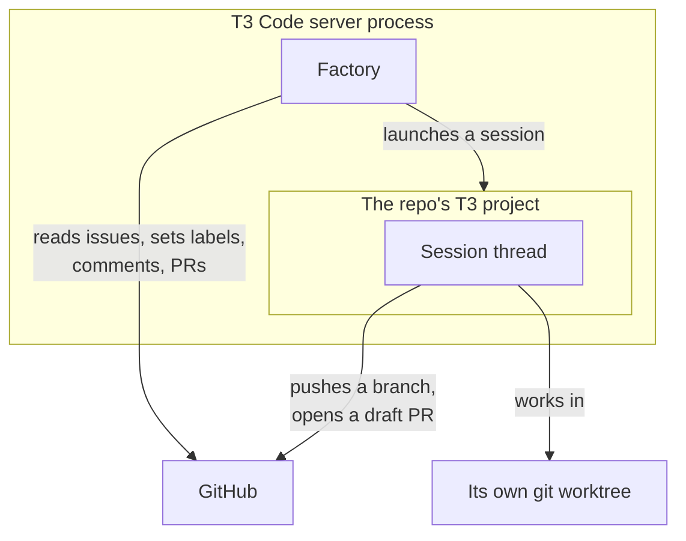
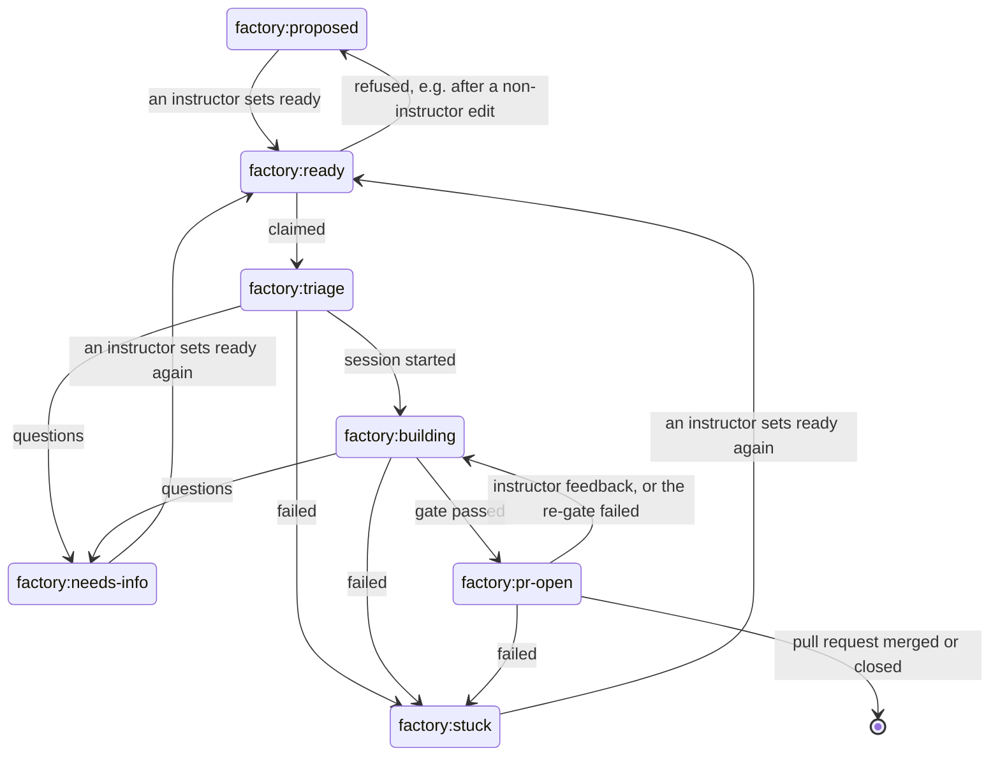

# What the factory is

The factory turns a GitHub issue into a draft pull request. A person writes the issue and labels it `factory:ready`. The factory claims it, starts an agent session that builds it, runs the repo's gate (its checks) on the result, and marks the pull request ready for review once the gate passes. A person reviews and merges. The factory never merges.

It runs inside the T3 Code server, as part of the same process. Each agent session is an ordinary T3 [thread](https://github.com/pingdotgg/t3code/tree/main/docs/user/thread-sidebar.md) in its own git worktree, so you can open it in T3 and read what the agent did.

## How an issue moves

1. A person files the issue and an [instructor](/guide/filing-work#instructors) sets `factory:ready`.
2. On its next pass the factory checks who set the label, assigns the issue to its own GitHub login and sets `factory:triage`.
3. It launches a session on the repo's T3 project and sets `factory:building`. The session builds the issue, opens a draft pull request and ends with a result line.
4. The factory runs the gate on a fresh checkout of the pull request. When it fails, the session gets the output and tries again, up to the repo's retry limit.
5. When the gate passes, the factory marks the pull request ready for review and sets `factory:pr-open`. It keeps watching the pull request for instructor feedback until it is merged or closed.

A session that cannot build the issue asks questions (`factory:needs-info`) or gives up with a reason (`factory:stuck`). [When a run stops](/guide/when-a-run-stops) covers both.

## What it is not

- It is not a separate app. The fork is upstream T3 Code plus the factory, and keeps taking upstream's changes every day.
- It has no factory-specific model setting. A session runs on the default model of the repo's T3 project, falling back to the default model in T3's own Settings. See [providers](https://github.com/pingdotgg/t3code/tree/main/docs/user/providers-claude.md) for setting one up.
- It reads GitHub issues only. One machine runs one factory, acting as one GitHub login.

## Where to go next

- [Install and run](/guide/install) the server.
- [Add a repo](/guide/add-a-repo) for it to watch.
- [File work](/guide/filing-work) it can build.
